# Awesome Internal Enterprise API Catalog

<p align="center">
  
</p>

<p align="center">
  <a href="https://github.com/ishandutta2007/Awesome-Awesome-Awesome"></a><a href="https://discord.gg/jc4xtF58Ve"></a>
  <a href="https://github.com/ishandutta2007/Awesome-Internal-Enterprise-API-Catalog/stargazers"></a>
  <a href="https://github.com/ishandutta2007/Awesome-Internal-Enterprise-API-Catalog/network/members"></a>
  <a href="https://github.com/ishandutta2007/Awesome-Internal-Enterprise-API-Catalog/issues"></a>
  <a href="https://github.com/ishandutta2007/Awesome-Internal-Enterprise-API-Catalog/blob/main/LICENSE"></a>
  <a href="https://github.com/ishandutta2007"></a>
</p>

---

## 🧭 Overview & Architecture

An authoritative, SEO-indexed, curated catalog of **Internal Enterprise API Catalogs**, **Internal Developer Portals (IDP)**, **Service Registries**, and **API Governance Platforms**. These mission-critical systems centralize organizational microservices, OpenAPI/AsyncAPI/GraphQL specifications, ownership metadata, architectural scorecards, and interactive API consoles—empowering platform engineers and enterprise developers to rapidly discover, govern, mock, and reuse internal APIs without duplicate engineering effort.

---

## 📑 Table of Contents
- [📊 Sector Overview & Market Dynamics](#-sector-overview--market-dynamics)
- [☁️ SaaS & Hosted Platforms](#️-saashosted-platforms)
- [🔓 Open-Source GitHub Projects](#-open-source-github-projects)
- [🧩 Architecture & Composition Patterns](#-architecture--composition-patterns)
- [🤝 How to Contribute](#-how-to-contribute)
- [💖 Support & Sponsorship](#-support--sponsorship)
- [📈 Star History](#-star-history)
- [📜 Disclaimer](#-disclaimer)

---

## 📊 Sector Overview & Market Dynamics

The Internal Developer Portal (IDP) and platform engineering market is valued at approximately **$8.87 Billion in 2026** (scaling towards $50+ Billion by the mid-2030s at an estimated ~21% CAGR), while the broader API management ecosystem spans between **$10.32 Billion and $16.29 Billion**. The internal developer portal segment is **moderately fragmented**—Spotify Backstage serves as a widespread open-source foundation, while commercial IDPs (Port, Cortex, OpsLevel, Configure8, Roadie) compete actively on turnkey workflows, developer self-service, and scorecards; conversely, the underlying gateway and API management core remains **moderately concentrated** around major enterprise titans (Apigee, MuleSoft, Kong, and hyperscalers).

---

## ☁️ SaaS & Hosted Platforms

The following table provides detailed starting tier prices and specific free tier / trial allowances for leading enterprise API catalog and developer portal solutions, sorted descending by free tier / trial flexibility:

| Platform | Category | Key Capabilities | Pricing | Free Tier / Trial Limits |
| :--- | :--- | :--- | :--- | :--- |
| **[Port](https://getport.io)** | Internal Developer Portal | Flexible software catalog, API registry, customizable self-service workflows, and engineering scorecards. | Starts at **$30 / seat / month** (Basic tier, billed annually) | **Free forever plan**: up to 15 seats, 10,000 catalog entities, and ~500 workflow runs/month (no credit card required). |
| **[Configure8](https://configure8.io)** | Universal Developer Portal | Consolidates services, APIs, cloud environments, dependencies, and operational health into a unified searchable portal. | Starts at **$22.89 / user / month** (Enterprise tier, billed annually) | **Free forever plan**: $0/user/month for unlimited catalog users & integrations (scorecards & self-serve actions capped at 10 users). |
| **[Redocly API Portal](https://redocly.com)** | API Governance & Registry | Automated OpenAPI bundling, linting, interactive developer reference portals, and role-based access. | Starts at **$249 / month** (Pro plan billed annually; unlimited seats) | **30-day free trial**: Full access to Pro/Scale features for 3 projects and unlimited team seats (no credit card required). |
| **[Kong Konnect](https://konghq.com)** | Cloud-Native API Hub & Portal | Multi-cloud API catalog and developer portal synchronizing OpenAPI specs directly from Kong Gateway. | Starts at **$25 / control plane / month** (Serverless) / **$200 / month** (Hybrid) | **30-day free trial**: Konnect Plus trial with 1 million requests included and full Developer Portal capabilities. |
| **[Postman Private API Network](https://postman.com)** | Enterprise API Network | Centralized organizational directory for discovering, sharing, governing, and testing approved APIs and collections. | Starts at **$49 / user / month** (Enterprise plan, billed annually) | **Free tier available for core Postman** (up to 3 team members); Private API Network requires Enterprise trial / evaluation POC via sales. |
| **[Roadie Backstage](https://roadie.io)** | Managed Spotify Backstage | Enterprise-ready SaaS hosting for Backstage with pre-configured OpenAPI catalog plugins, TechDocs, and scorecards. | Starts at **$24 / developer / month** (Teams plan, billed annually) | **Custom trial / Guided evaluation POC**: 14 to 30 days guided onboarding available upon demo request (no self-serve free tier). |
| **[Google Cloud Apigee API Hub](https://google.com)** | Enterprise API Governance Hub | Universal enterprise registry to discover, organize, and govern APIs across multi-cloud and multi-gateway environments. | Starts at **~$365 / environment / month** + **$20 per 1M calls** (Pay-As-You-Go) | **Google Cloud Free Tier**: $300 credit for 90 days across GCP; Apigee API Hub included with Apigee environment lifecycle. |
| **[OpsLevel](https://opslevel.com)** | Service Catalog & IDP | Developer portal providing automated API and microservice discovery, maturity rubrics, and golden paths. | Custom quote per developer (typically **~$20–$40 / developer / month** list) | **14 to 30-day customized trial / POC**: Available for qualified engineering teams following a solution demo (no permanent free tier). |
| **[Cortex](https://cortex.io)** | Developer Portal & Scorecards | Tracks microservice ownership, API documentation, production readiness scorecards, and SLO standards. | Custom quote based on seats & services (AWS Marketplace list starts at **~$65 / seat / month**) | **Guided evaluation / POC**: Tailored evaluation period provided via sales demonstration (no public self-serve free tier). |
| **[MuleSoft Anypoint Exchange](https://mulesoft.com)** | Enterprise Integration Catalog | Centralized marketplace to discover, publish, and consume REST, SOAP, GraphQL, AsyncAPI, and integration flows. | Starts at **$2,000 / month** ($24,000 / year for Integration Starter) | **Guided enterprise POC**: 30-day evaluation with allotted Mule Credits arranged via Salesforce/MuleSoft sales team. |

---

## 🔓 Open-Source GitHub Projects

Curated open-source software for hosting internal developer portals, API schema registries, API gateways, and governance linters—sorted in descending order by **GitHub Stargazers**:

1. **[Kong Gateway](https://github.com/Kong/kong)** [](https://github.com/Kong/kong/stargazers)  
   Cloud-native API gateway and microservice management layer that powers high-performance routing and automated API registration into internal service catalogs.

2. **[Backstage (by Spotify)](https://github.com/backstage/backstage)** [](https://github.com/backstage/backstage/stargazers)  
   The industry-standard open-source CNCF framework for building custom Internal Developer Portals, featuring a software catalog, TechDocs, and extensible API explorer plugins.

3. **[Swagger UI](https://github.com/swagger-api/swagger-ui)** [](https://github.com/swagger-api/swagger-ui/stargazers)  
   The ubiquitously adopted open-source renderer for interactive OpenAPI and Swagger specifications inside internal engineering catalogs and gateways.

4. **[Redoc](https://github.com/Redocly/redoc)** [](https://github.com/Redocly/redoc/stargazers)  
   Clean, responsive three-panel OpenAPI documentation engine widely embedded in private enterprise portals for searchable API reference catalogs.

5. **[Apache APISIX](https://github.com/apache/apisix)** [](https://github.com/apache/apisix/stargazers)  
   Dynamic, real-time cloud-native API gateway offering OpenAPI schema validation, service registry synchronization, and developer portal dashboards.

6. **[Scalar](https://github.com/scalar/scalar)** [](https://github.com/scalar/scalar/stargazers)  
   Modern, elegant interactive API documentation engine and REST testing client designed for self-hosted internal developer reference hubs.

7. **[OpenMetadata](https://github.com/open-metadata/OpenMetadata)** [](https://github.com/open-metadata/OpenMetadata/stargazers)  
   Unified open-source metadata governance platform providing schema cataloging, data/API lineage, and discovery across enterprise data services.

8. **[Tyk API Gateway](https://github.com/TykTechnologies/tyk)** [](https://github.com/TykTechnologies/tyk/stargazers)  
   Lightweight, high-performance open-source API gateway written in Go with built-in OpenAPI import, catalog publishing, and security governance.

9. **[Apache ShenYu](https://github.com/apache/shenyu)** [](https://github.com/apache/shenyu/stargazers)  
   Asynchronous, multi-protocol microservice API gateway supporting automated Dubbo, gRPC, Spring Cloud, and REST endpoint registry cataloging.

10. **[KubeVela](https://github.com/kubevela/kubevela)** [](https://github.com/kubevela/kubevela/stargazers)  
    Modern application delivery and platform engineering engine based on Open Application Model (OAM) for building developer self-service catalogs.

11. **[Stoplight Prism](https://github.com/stoplightio/prism)** [](https://github.com/stoplightio/prism/stargazers)  
    Open-source HTTP mock server that generates real-world mock APIs and dynamic contract validation directly from OpenAPI specs in your internal catalog.

12. **[kin-openapi](https://github.com/getkin/kin-openapi)** [](https://github.com/getkin/kin-openapi/stargazers)  
    Comprehensive OpenAPI 3.0 and 3.1 validation, serialization, and query library in Go, heavily used to build custom internal catalog indexers.

13. **[Spectral (by Stoplight)](https://github.com/stoplightio/spectral)** [](https://github.com/stoplightio/spectral/stargazers)  
    Flexible JSON/YAML linter and style-guide validator enforcing enterprise security and naming conventions before APIs are indexed in the catalog.

14. **[EventCatalog](https://github.com/event-catalog/eventcatalog)** [](https://github.com/event-catalog/eventcatalog/stargazers)  
    Open-source discovery and documentation portal built specifically for Event-Driven Architectures (EDA), Kafka topics, and AsyncAPI specifications.

15. **[KrakenD](https://github.com/krakend/krakend-ce)** [](https://github.com/krakend/krakend-ce/stargazers)  
    Ultra-high-performance open-source API Gateway and Backend-For-Frontend (BFF) engine with automated OpenAPI specification export and service cataloging.

16. **[Microcks](https://github.com/microcks/microcks)** [](https://github.com/microcks/microcks/stargazers)  
    Kubernetes-native open-source tool for API mocking and contract testing across OpenAPI, AsyncAPI, GraphQL, and gRPC catalog assets.

17. **[Optic](https://github.com/opticdev/optic)** [](https://github.com/opticdev/optic/stargazers)  
    Git-first API governance and automated CI/CD breaking-change detector that verifies live API traffic against registered OpenAPI schemas.

18. **[oasdiff](https://github.com/Tufin/oasdiff)** [](https://github.com/Tufin/oasdiff/stargazers)  
    High-speed Go CLI and library for detecting breaking changes and diffing OpenAPI specs to automate catalog changelogs and release validations.

19. **[WunderGraph Cosmo](https://github.com/wundergraph/cosmo)** [](https://github.com/wundergraph/cosmo/stargazers)  
    Complete open-source GraphQL federation platform, schema registry, router, and enterprise developer analytics suite.

20. **[AsyncAPI Generator](https://github.com/asyncapi/generator)** [](https://github.com/asyncapi/generator/stargazers)  
    Code and documentation generator for AsyncAPI specifications, turning internal event broker schemas into interactive catalogs and SDKs.

21. **[WSO2 API Manager](https://github.com/wso2/product-apim)** [](https://github.com/wso2/product-apim/stargazers)  
    Fully open-source end-to-end API lifecycle management platform with API Publisher, Developer Portal catalog, policy engine, and analytics.

22. **[Apicurio Registry](https://github.com/apicurio/apicurio-registry)** [](https://github.com/apicurio/apicurio-registry/stargazers)  
    Event and API schema registry providing version control and governance for OpenAPI, AsyncAPI, GraphQL, Apache Avro, Protobuf, and JSON Schemas.

23. **[Kratix](https://github.com/syntasso/kratix)** [](https://github.com/syntasso/kratix/stargazers)  
    Open-source framework that enables platform teams to build multi-cluster cloud-native capabilities and self-service API golden paths.

24. **[GraphQL Hive](https://github.com/graphql-hive/console)** [](https://github.com/graphql-hive/console/stargazers)  
    Open-source GraphQL schema registry and monitoring dashboard supporting schema checks, federation, and breaking-change detection.

25. **[Gravitee API Management](https://github.com/gravitee-io/gravitee-api-management)** [](https://github.com/gravitee-io/gravitee-api-management/stargazers)  
    Flexible open-source API management suite featuring an integrated developer portal, API publisher catalog, and policy studio.

26. **[Ortelius](https://github.com/ortelius/ortelius)** [](https://github.com/ortelius/ortelius/stargazers)  
    Open-source microservice catalog tracking software supply chain security, SBOMs, API endpoints, and cross-service dependencies across clusters.

27. **[AsyncAPI Studio](https://github.com/asyncapi/studio)** [](https://github.com/asyncapi/studio/stargazers)  
    Browser-based interactive IDE and live renderer for designing, validating, and previewing AsyncAPI message catalogs and event streams.

---

## 🧩 Architecture & Composition Patterns

Enterprise organizations achieve modularity by chaining specialized open-source building blocks:
```
┌────────────────────────────────────────────────────────┐
│             Internal Developer Portal                  │
│       (Backstage / Port / Configure8 / Roadie)         │
└───────────────────────────┬────────────────────────────┘
                            │
       ┌────────────────────┼────────────────────┐
       ▼                    ▼                    ▼
┌──────────────┐     ┌──────────────┐     ┌──────────────┐
│  API Catalogs│     │ Schema & EDA │     │  Governance  │
│  & Consoles  │     │  Registries  │     │   & Linters  │
│(Scalar/Redoc)│     │(Apicurio/Hive│     │(Spectral/Diff│
└──────┬───────┘     └──────┬───────┘     └──────┬───────┘
       │                    │                    │
       └────────────────────┼────────────────────┘
                            ▼
┌────────────────────────────────────────────────────────┐
│           Runtime Gateway & Control Plane              │
│         (Kong / Apache APISIX / Tyk / ShenYu)          │
└────────────────────────────────────────────────────────┘
```

---

## 🤝 How to Contribute

Contributions are warmly welcomed! To suggest a new open-source project or enterprise platform:
1. 🍴 Fork the repository.
2. 📝 Update `README.md` following the established table / list format.
3. 🔎 Verify GitHub_Stars or current pricing tiers with factual references.
4. 🚀 Submit a Pull Request with a clear description of the project.

---

## 💖 Support & Sponsorship

If you find this catalog valuable for your platform engineering initiatives, please consider supporting the project:

- ⭐ **Star this repository** to help others discover enterprise API tooling.
- 🍴 **Fork and share** it with your engineering team and DevOps communities.
- ☕ **Sponsor the maintainer** via [GitHub Sponsors Dashboard](https://github.com/sponsors/ishandutta2007) to help sustain continuous updates and curated open-source research.

---

## 📈 Star History

[](https://www.star-history.com/#ishandutta2007/Awesome-Internal-Enterprise-API-Catalog&type=date&legend=top-left)

---

## 📜 Disclaimer

- This is a **community-curated** directory provided for architectural reference and technical evaluation—not an endorsement.
- Internal enterprise API catalogs frequently display sensitive system topologies, private routes, and authorization schemes; always implement zero-trust SSO, RBAC, and network isolation before deployment.
- Product names, logos, and brands belong to their respective copyright holders.
